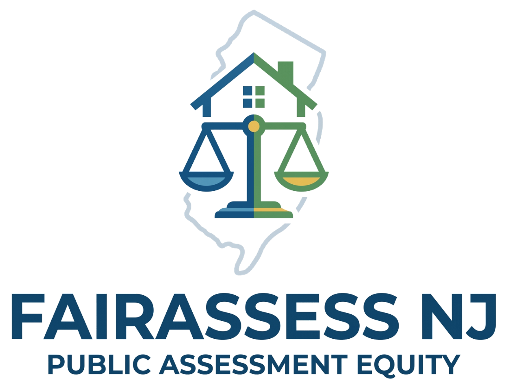
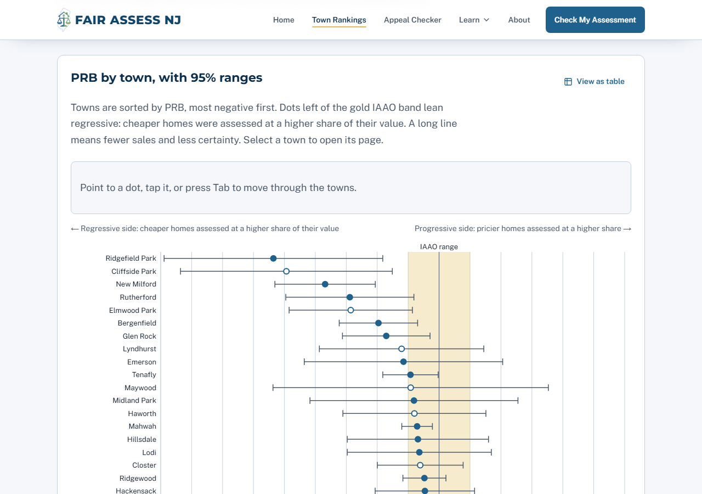
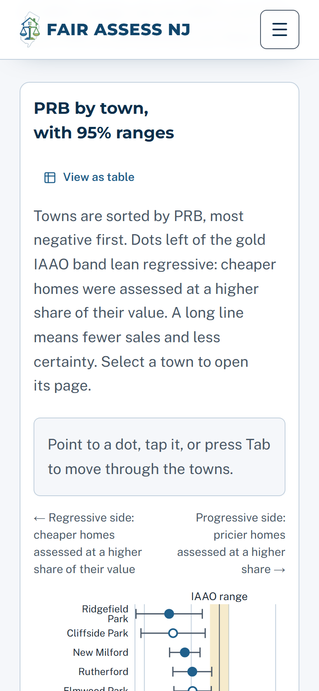
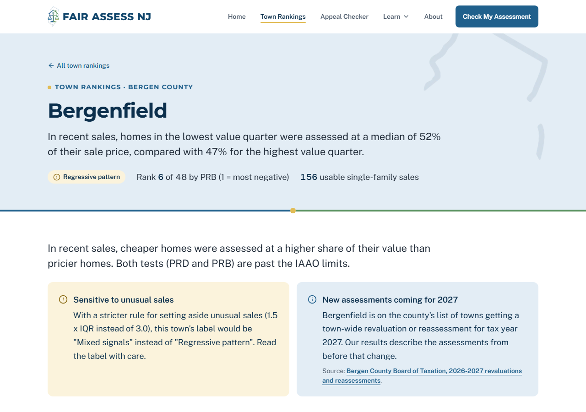
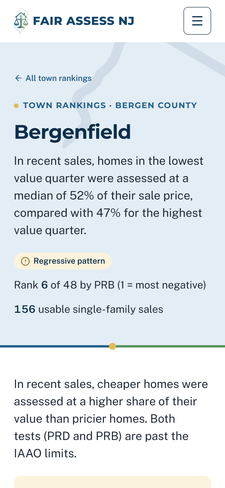
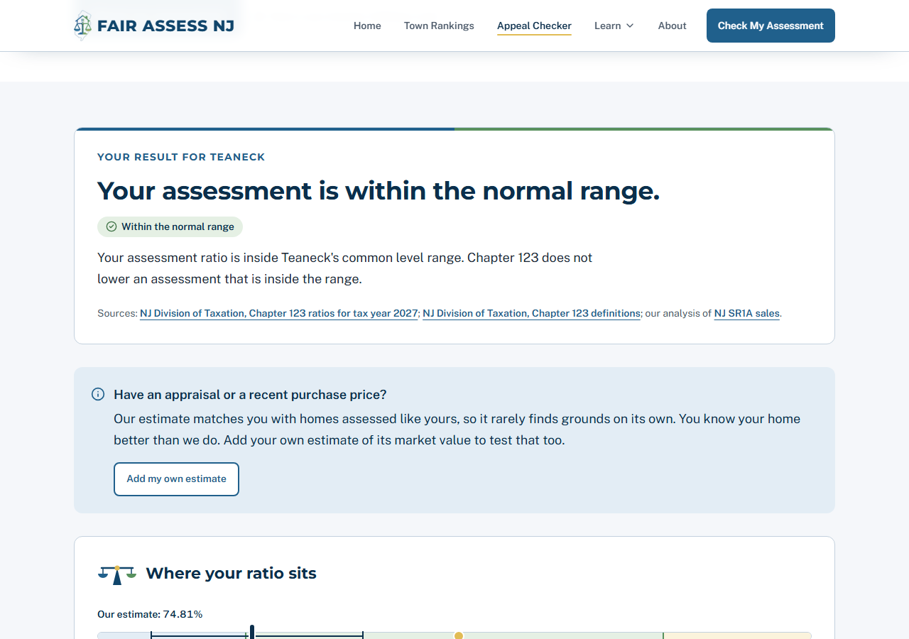
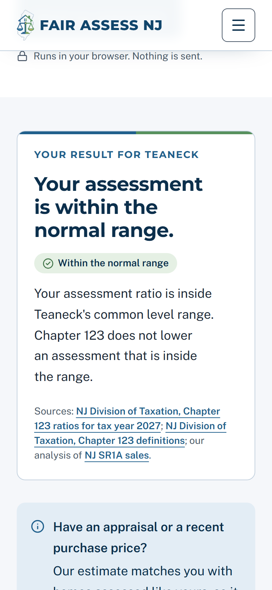
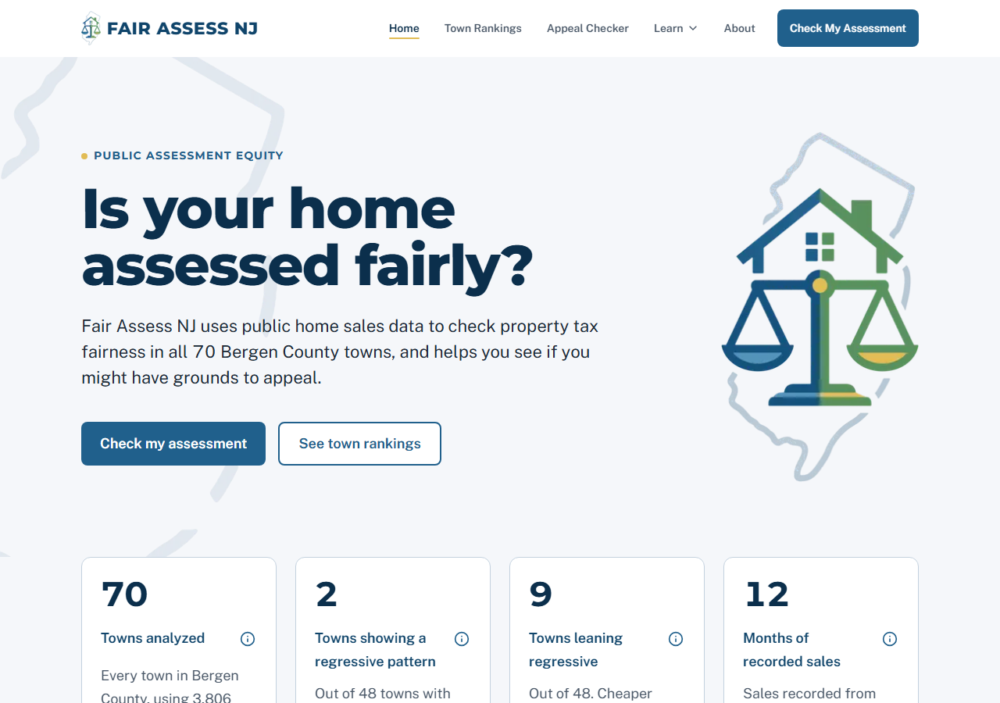
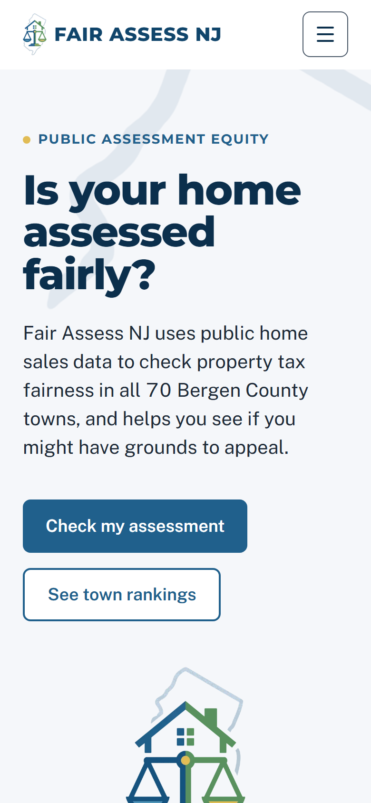

<p align="center">
  
</p>

<h1 align="center">FairAssess NJ</h1>

<p align="center"><strong>Public Assessment Equity</strong></p>

<p align="center">
  A free website that uses public home sales data to show whether Bergen County, New Jersey towns assess homes fairly, and to help homeowners see if a property tax appeal may be worth filing.
</p>

<p align="center">
  <a href="https://fairassessnj.vercel.app"><strong>fairassessnj.vercel.app</strong></a>
  &nbsp;·&nbsp;
  <a href="https://github.com/zmpothacamury-png/fairassess-nj/actions/workflows/ci.yml"></a>
</p>

---

## What it does

Version 1 covers the 70 towns in Bergen County and single-family homes only.

### 1. Town rankings

For each home that sold, we divide its assessed value by its sale price. That share is called the **assessment ratio**. In a fair town, cheap and expensive homes have about the same ratio. We check this with three standard tests from the IAAO (International Association of Assessing Officers):

- **PRB** (price-related bias) shows whether ratios fall or rise as home values go up. We rank towns by PRB.
- **PRD** (price-related differential) is a second check on the same question.
- **COD** (coefficient of dispersion) shows how even the assessments are overall.

A town gets the "Regressive pattern" label only when PRD and PRB both say cheaper homes are assessed at a higher share of their value. Of the 48 towns with enough sales (20 or more), 2 show a regressive pattern, 1 a progressive pattern, 28 are within standards, and 17 show mixed signals. These labels describe patterns in past sales. They are not findings about any assessor.

| Desktop | Phone |
|---|---|
|  |  |
|  |  |

### 2. Appeal checker

A homeowner picks their town and types their assessed value. The checker:

1. finds recent sales in that town of homes assessed close to theirs,
2. adjusts those sale prices to October 1, 2026 with a county price index,
3. estimates a market value range, and
4. applies New Jersey's **Chapter 123** test. The state publishes an average ratio for each town. The **common level range** is that ratio plus or minus 15%. If a home's own ratio is above the range, the owner may have grounds to appeal.

It then says, in plain English, one of five things: you may have grounds to appeal, you are within the normal range, your assessment may be lower than typical, there is not enough data, or (in a town getting new assessments for 2027) Chapter 123 does not apply this year. It never says "you will win."

Every result shows the appeal deadline and the filing fee. For tax year 2027, an appeal must be **received** by **April 1, 2027**, or by **May 1, 2027** in a town with a town-wide revaluation or reassessment. A deadline on a weekend or holiday moves to the next business day. The fee depends on the assessed value: **$5** under $150,000; **$25** from $150,000 to under $500,000; **$100** from $500,000 to under $1,000,000; **$150** at $1,000,000 or more. Source: [NJ Form A-1, Petition of Appeal](https://nj.gov/treasury/taxation/pdf/other_forms/lpt/petappl.pdf). Confirm with the [Bergen County Board of Taxation](https://bergencountynj.gov/boards-commissions/about-board-of-taxation/).

**Privacy:** all checker math runs in the visitor's browser. Nothing a homeowner types is sent, saved, or logged.

| Desktop | Phone |
|---|---|
|  |  |
|  |  |

The checker screenshots use an example input (Teaneck, assessed value $450,000), not a real home.

## Why it matters

A New Jersey property tax bill is based on the assessed value the town sets, and every home in a town pays the same tax rate on that value. If one home is assessed at a higher share of what it is worth, its owner pays more than their fair share. When that happens to cheaper homes more than expensive ones, the families who can least afford it carry more of the tax.

## How it works

```
 NJ SR1A sales files            NJ state files
 (every recorded home sale)     (Chapter 123 ratios, Director's ratios,
                                 deviation tables, tax rates)
            │                              │
            └──────────────┬───────────────┘
                           ▼
          ┌─────────────────────────────────┐
          │ Python pipeline (run locally)   │   pipeline/
          │ parse → clean → stats →         │
          │ validate → index → export       │
          └─────────────────────────────────┘
                           │
                           ▼
          Validated JSON files               site/public/data/
          (checked against a data contract;
           a bad file stops the build)
                           │
                           ▼  git push → Vercel builds site/
          ┌─────────────────────────────────┐
          │ Next.js website on Vercel       │
          │  • town pages read the JSON     │
          │  • the appeal checker runs in   │──── nothing typed is
          │    the visitor's browser        │     sent, saved, or logged
          └─────────────────────────────────┘
```

No analysis runs on a server. Supabase is used only for the email waitlist. More detail: [docs/architecture.md](docs/architecture.md).

## Methodology in brief

- **Sales:** the state's SR1A file of deeds recorded July 1, 2025 to June 30, 2026. That is the same year of sales the state used for its 2027 ratios. We keep usable, single-family (class 2) sales and set aside condos, sales the state marks as not showing a fair price, and a few very unusual ratios. That leaves 3,806 sales.
- **Town measures:** median ratio, COD, PRD, and PRB, each with a 95% range, for towns with 20 or more sales. Labels need PRD and PRB to agree.
- **Checker:** comparable sales assessed within 15% of the home (widened to 25% if there are fewer than 8), weighted toward closer and more recent sales. At least 5 are needed.

**Validation:** For 70 of 70 Bergen towns, our ratio was within 5 points of the state's, and for 66 it was within 1 point. (That is when we follow the state's own method: weighted by price and by property class, before the state blends in last year's value.) We also match the state's sale counts in all 70 towns. Full details: [docs/validation.md](docs/validation.md).

Read the plain-English version at [fairassessnj.vercel.app/methodology](https://fairassessnj.vercel.app/methodology). Every rule is in [docs/methodology.md](docs/methodology.md), which is the source of truth for the code.

## Run it yourself

These commands are for **Windows PowerShell**. Run them from the folder where you cloned the repo. You need [Python 3.11 or newer](https://www.python.org/downloads/), [Node.js](https://nodejs.org/) (the automatic checks use version 24), and Git.

### 1. Get the raw data

The raw files are public, but they are too big to keep in this repo. These commands download them from the [NJ Division of Taxation](https://www.nj.gov/treasury/taxation/lpt/statdata.shtml) into `data\raw\`:

```powershell
New-Item -ItemType Directory -Force data\raw\sr1a, data\raw\state | Out-Null
$ProgressPreference = "SilentlyContinue"   # makes the downloads much faster
$base = "https://www.nj.gov/treasury/taxation"
$files = [ordered]@{
  "data\raw\sr1a\Sales2024.zip"              = "$base/lpt/statdata/Sales2024.zip"
  "data\raw\sr1a\Sales2025.zip"              = "$base/lpt/statdata/Sales2025.zip"
  "data\raw\sr1a\Sales2026.zip"              = "$base/lpt/statdata/Sales2026.zip"
  "data\raw\sr1a\YTDSR1A2026.zip"            = "$base/lpt/statdata/YTDSR1A2026.zip"
  "data\raw\sr1a\SR1Afilelayout.pdf"         = "$base/pdf/lpt/SR1Afilelayout.pdf"
  "data\raw\state\2027CH123.pdf"             = "$base/pdf/lpt/chap123/2027CH123.pdf"
  "data\raw\state\2026CH123.pdf"             = "$base/pdf/lpt/chap123/2026CH123.pdf"
  "data\raw\state\ch123definitions.pdf"      = "$base/pdf/lpt/chap123/ch123definitions.pdf"
  "data\raw\state\2026TEV.pdf"               = "$base/pdf/lptval/2026/2026TEV.pdf"
  "data\raw\state\2025TEV.pdf"               = "$base/pdf/lptval/2024/2025TEV.pdf"
  "data\raw\state\DirRatios.xlsx"            = "$base/lpt/tev/DirRatios.xlsx"
  "data\raw\state\CoefficientDeviations.pdf" = "$base/pdf/lpt/CoefficientDeviations.pdf"
  "data\raw\state\2026AvgResStat.pdf"        = "$base/pdf/lpt/class4/2026AvgResStat.pdf"
  "data\raw\state\GTRhistory.xlsx"           = "$base/lpt/GTRhistory.xlsx"
  "data\raw\state\2025taxrates.pdf"          = "$base/pdf/lpt/gtr/2025taxrates.pdf"
}
foreach ($f in $files.GetEnumerator()) {
  Write-Host "Downloading $($f.Key)"
  Invoke-WebRequest -Uri $f.Value -OutFile $f.Key -UseBasicParsing
}
```

Each link was checked on October 18, 2026, against the copies used to build the site. The state updates some of these files over time, so a newer download may give slightly different numbers.

### 2. Set up Python

```powershell
py -m venv .venv
.\.venv\Scripts\python.exe -m pip install -r pipeline\requirements.txt
```

### 3. Run the pipeline

One command runs every stage in order (parse, clean, stats, validate, index, export, fixtures). It stops with a clear message if an input file is missing.

```powershell
.\.venv\Scripts\python.exe -m pipeline.run
```

To rerun one stage and every stage after it, name it, for example `.\.venv\Scripts\python.exe -m pipeline.run stats`. The pipeline writes tables to `data\processed\` and the website's files to `site\public\data\`. Every file and field the site reads is described in [docs/data-contract.md](docs/data-contract.md).

### 4. Run the website

```powershell
cd site
npm install
npm run dev
```

Then open http://localhost:3000. The email waitlist needs Supabase keys in `site\.env.local` (copy `site\.env.local.example`). Everything else works without them.

### 5. Run every check

From the main project folder:

```powershell
powershell -ExecutionPolicy Bypass -File scripts\check-all.ps1
```

This runs the Python tests, the site's unit tests, lint, the data check, the build, and the browser tests, then prints PASS or FAIL for each. Add `-SkipE2E` to skip the browser tests (the slowest step). The first time, install the test browser with `cd site; npx playwright install chromium`.

## Project structure

```
fairassess-nj/
├── .github/        Automatic checks (CI) and issue templates
├── brand/          Original logo files
├── data/
│   ├── raw/        Downloads from the state (not in the repo; see "Get the raw data")
│   ├── interim/    Temporary pipeline files (not in the repo)
│   ├── processed/  Final pipeline tables (CSV)
│   └── reference/  Revaluation towns and non-usable sale codes
├── docs/           Methodology, validation, data contract, quality report, changelog, screenshots
├── notebooks/      Exploratory notebooks (empty in v1)
├── pipeline/       Python data pipeline; tests in pipeline/tests/
├── reports/        Memos and one-page town findings (empty in v1)
├── scripts/        check-all.ps1: runs every check on Windows
└── site/           The Next.js website (Vercel builds only this folder)
```

## Testing

Every calculation has a test. The same checks run on every push to GitHub ([.github/workflows/ci.yml](.github/workflows/ci.yml)) and on a Windows PC with `scripts\check-all.ps1`.

- **Python unit tests** (pytest, `pipeline/tests/`): parsing, every cleaning rule, the ratio measures, confidence ranges, the price index, validation, and the export. Tests that need the raw data skip themselves when it is missing.
- **Two independent checker versions:** the appeal checker is written twice, once in TypeScript for the website (`site/lib/checker/`) and once in Python as a reference (`pipeline/checker_reference.py`), each from the methodology. Both must give the same answer on 58 test cases (real towns, edge cases, and invalid inputs), and both must match 3 cases worked out by hand.
- **Site unit tests** (Vitest): the checker, number formatting, chart helpers, color contrast, navigation, and search tags.
- **End-to-end tests** (Playwright, against the production build): every page, all five checker results, the rankings chart matching its table, keyboard use, phone layouts, and reduced motion.
- **Privacy test:** while the checker runs, the test watches every request, the URL, and browser storage, and fails if any typed value shows up.
- **Accessibility:** axe-core scans every page for WCAG 2.1 A and AA problems; other tests check visible focus, 200% zoom, and that every chart has a table.
- **Data check:** `npm run validate-data` checks every JSON file against the data contract. The build fails if one is wrong.

Results from Lighthouse and the accessibility scans are in [docs/quality-report.md](docs/quality-report.md).

## Data sources and license

All data comes from public records:

- [NJ Division of Taxation, Statistical Information](https://www.nj.gov/treasury/taxation/lpt/statdata.shtml): SR1A sales files, Director's ratios, coefficient of deviation tables, average residential statistics, and general tax rates.
- [NJ Division of Taxation, Chapter 123 ratios for tax year 2027](https://www.nj.gov/treasury/taxation/pdf/lpt/chap123/2027CH123.pdf) and [Chapter 123 definitions](https://www.nj.gov/treasury/taxation/pdf/lpt/chap123/ch123definitions.pdf).
- [NJ Division of Taxation, 2026 Table of Equalized Valuations](https://www.nj.gov/treasury/taxation/pdf/lptval/2026/2026TEV.pdf) and [2025 Table](https://www.nj.gov/treasury/taxation/pdf/lptval/2024/2025TEV.pdf).
- [NJ Division of Taxation, Guidelines for use of 36 Nonusable Categories](https://www.nj.gov/treasury/taxation/pdf/lpt/guidelines36.pdf).
- [Bergen County Board of Taxation, 2026-2027 revaluations and reassessments](https://bergencountynj.gov/wp-content/uploads/2026/01/2026-2027-Revaluations-and-Reassessments.pdf).
- [NJ Form A-1, Petition of Appeal](https://nj.gov/treasury/taxation/pdf/other_forms/lpt/petappl.pdf) (deadlines and fees).

The processed data has no owner names or street addresses.

**License:** the code is under the [MIT License](LICENSE). Our reports and processed data (`data/processed/`, `site/public/data/`, and the downloadable CSV) are under [CC-BY 4.0](https://creativecommons.org/licenses/by/4.0/). The original records belong to the State of New Jersey and Bergen County.

## Roadmap (Version 2.0)

- Cover all of New Jersey.
- Address lookup using the state's MOD-IV parcel records.
- A stronger fairness test using a regression model that accounts for home features like size and age.
- Testing whether assessments get less fair each year after a town's last revaluation.
- Collecting appeal results from county tax boards.
- A Spanish version and easier design for older homeowners.

## Disclaimer

FairAssess NJ is an independent student research project that uses public data. It is not legal, tax, or appraisal advice. Homeowners file and present their own appeals. Confirm deadlines, fees, and forms with the Bergen County Board of Taxation.

## Author and contact

Built by **Zaden Pothacamury**, Ramapo High School.

- Email: [fairassessnj@gmail.com](mailto:fairassessnj@gmail.com)
- Found a bug or a number that looks wrong? [Open an issue](https://github.com/zmpothacamury-png/fairassess-nj/issues/new/choose). See [CONTRIBUTING.md](CONTRIBUTING.md).
